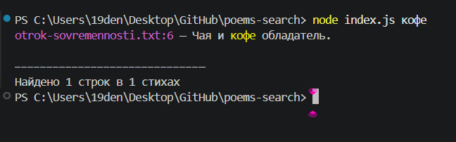

# 📖 Поиск по стихам

CLI-инструмент для поиска строк в `.txt`-файлах. Ищет по одному или двум словам, подсвечивает найденное, показывает статистику.



## ✨ Что умеет

- 🔍 Поиск по одному или двум словам
- 🎨 Цветной вывод в терминале
- 🖍️ Подсветка найденных слов
- 📊 Счётчик: сколько строк и в скольких файлах
- 🛡️ Понятные сообщения об ошибках

## 📋 Что нужно

- **Node.js** версии 18 или новее — [скачать](https://nodejs.org/)
- **Терминал** — PowerShell (в Windows), Terminal (в macOS/Linux)

## ⚡ Быстрый старт

### 1. Установи Node.js

Скачай с [nodejs.org](https://nodejs.org/) и установи как обычную программу. Выбирай **LTS-версию**.

Проверь, что установилось — открой терминал и введи:

```
node --version
```

Должно показать что-то вроде `v20.11.0`. Если показывает — всё ок.

### 2. Скачай проект

**Вариант А (простой):** на странице репозитория нажми зелёную кнопку **`<> Code`** → **Download ZIP**. Распакуй в удобное место.

**Вариант Б (для тех, кто знает Git):**

```
git clone https://github.com/Hemlock1988/poems-search.git
```

### 3. Открой терминал в папке проекта

- **Windows 11:** правый клик по папке → «Открыть в терминале»
- **Windows 10:** Shift + правый клик → «Открыть окно PowerShell здесь»
- **macOS:** правый клик → «Службы» → «Новый терминал в папке»
- **Linux:** правый клик → «Открыть в терминале»

### 4. Запусти

```
node index.js дорога
```

Готово! Ты увидишь строки, где встречается слово «дорога».

## 📖 Как использовать

**Поиск по одному слову:**

```
node index.js дорога
```

**Поиск по двум словам** (найдёт строки, где есть хотя бы одно):

```
node index.js дорога луна
```

**Без аргументов** — покажет подсказку:

```
node index.js
```

## 📁 Свои стихи

По умолчанию скрипт ищет в папке `poems/`. Чтобы искать **в своих файлах**:

1. Открой папку `poems/`.
2. Удали мои стихи (или оставь их).
3. Положи туда свои `.txt`-файлы.
4. Запусти `node index.js слово`.

**Важно:** файлы должны быть в кодировке **UTF-8**, иначе русские буквы превратятся в кракозябры.

## ❓ Если не работает

**`'node' is not recognized`** — Node.js не установлен или терминал не перезапущен после установки. Установи [Node.js](https://nodejs.org/) и открой терминал заново.

**`Папка ./poems не найдена`** — ты запускаешь скрипт не из папки проекта. Открой терминал **в папке** `poems-search` и запусти снова.

**Русские буквы отображаются как кракозябры** — файлы не в UTF-8. Открой их в VS Code → внизу справа выбери кодировку → «Save with encoding» → UTF-8.

## 📂 Структура

```
poems-search/
├── index.js          # основной скрипт
├── colors.js         # цветной вывод и подсветка
├── poems/            # txt-файлы для поиска
├── screenshot.png    # скриншот работы
├── .gitignore        # что не выкладывается
└── README.md         # этот файл
```

## 🛠️ Как это работает

1. Читает все `.txt`-файлы из папки `poems/`.
2. Разбивает каждый файл на строки.
3. Ищет строки, содержащие искомые слова (регистр не важен).
4. Подсвечивает найденные слова жёлтым.
5. Считает статистику: сколько строк и в скольких файлах.

## 📄 Лицензия

MIT — используй как хочешь.
